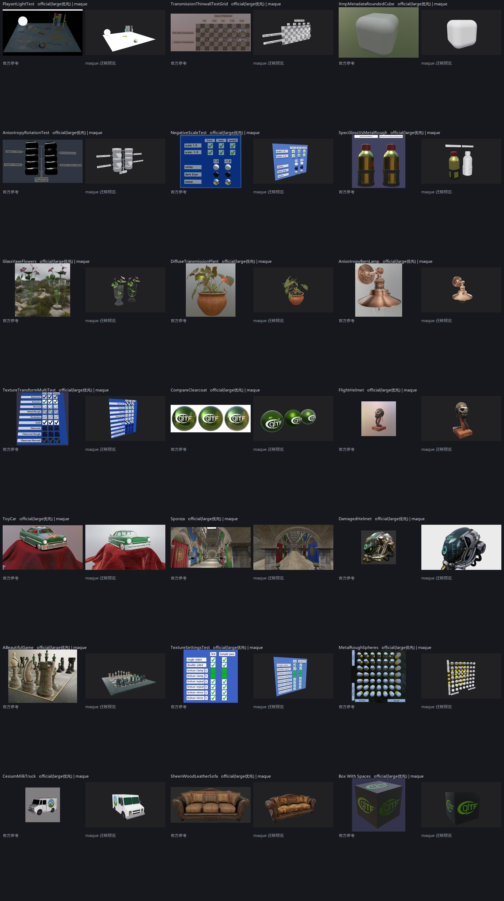

# Khronos glTF-Sample-Assets × maque 迁移对比报告

> 逐模型对比官方参考图（**large 优先**）与 maque 迁移后的渲染预览。
> 打开 [index.html](index.html) 查看左右对比（支持搜索/筛选/排序）。

- 模型：**149**（149 个有自动对比；86 个参考图使用 large 版，13 个为 GIF 首帧）
- 指标中位数：直方图相似度 **0.507**、前景平均亮度差 **+0.073**、
  前景 RGB 距离 **0.112**、预览前景占比 **17.3%**
- 自动初判：较接近 **49** / 中等 **46** / 差异较大 **54**
- 参考图下采样：≤900px、JPEG q82，存于 `ref/`；预览来自 `scenes/khronos/<Model>/preview.jpg`
- 复现：`python tools/make_migration_report.py`；表格数据：[comparison.csv](comparison.csv)、[comparison.json](comparison.json)

> ⚠️ **不是像素级 pass/fail**：官方图多为离线渲染（HDRI studio、软阴影、不同机位/背景、含透明背景），
> maque 有 opt-in PMREM envmap/IBL（真 GGX 预过滤 + 漫反射 irradiance + 天空）/ 扩展材质贴图（含 specular），
> 但无真实折射（transmission 为 alpha 近似）/ 软阴影 / 动画骨骼。指标只用于筛查，差异需人工归因
> （见各模型 README 的「与官方 screenshot 对比」与「人工视觉复核」；迁移方法与踩坑见
> [docs/31-gltf-model-migration.md](../../docs/31-gltf-model-migration.md)）。

## 最需人工关注的 15 个模型（直方图相似度最低）

| 模型 | 参考图 | 直方图相似度 | 亮度差 | 前景占比 | 自动初判 | 差距数 |
|---|---|---|---|---|---|---|
| [BoxInterleaved](#model-BoxInterleaved) | screenshot.png | 0.004 | 0.042 | 26.9% | 差异较大（需人工确认：机位/缺失特性/导入问题） | 0 |
| [AnimatedTriangle](#model-AnimatedTriangle) | screenshot.gif（GIF） | 0.005 | 0.369 | 18.5% | 差异较大（需人工确认：机位/缺失特性/导入问题） | 1 |
| [Box](#model-Box) | screenshot.png | 0.006 | 0.127 | 26.9% | 差异较大（需人工确认：机位/缺失特性/导入问题） | 0 |
| [Cameras](#model-Cameras) | screenshot.png | 0.007 | 0.445 | 23.5% | 差异较大（需人工确认：机位/缺失特性/导入问题） | 1 |
| [AnimatedMorphCube](#model-AnimatedMorphCube) | screenshot.gif（GIF） | 0.007 | 0.535 | 26.8% | 差异较大（需人工确认：机位/缺失特性/导入问题） | 2 |
| [BoxAnimated](#model-BoxAnimated) | screenshot.gif（GIF） | 0.012 | 0.542 | 28.1% | 差异较大（需人工确认：机位/缺失特性/导入问题） | 1 |
| [Triangle](#model-Triangle) | screenshot.png | 0.013 | 0.367 | 16.6% | 差异较大（需人工确认：机位/缺失特性/导入问题） | 0 |
| [TriangleWithoutIndices](#model-TriangleWithoutIndices) | screenshot.png | 0.013 | 0.367 | 16.6% | 差异较大（需人工确认：机位/缺失特性/导入问题） | 0 |
| [SimpleMeshes](#model-SimpleMeshes) | screenshot.png | 0.014 | 0.362 | 22.7% | 差异较大（需人工确认：机位/缺失特性/导入问题） | 0 |
| [SimpleMorph](#model-SimpleMorph) | screenshot.png | 0.030 | 0.115 | 19.6% | 差异较大（需人工确认：机位/缺失特性/导入问题） | 2 |
| [PlaysetLightTest](#model-PlaysetLightTest) | screenshot_large.jpg（large） | 0.031 | 0.820 | 17.5% | 差异较大（需人工确认：机位/缺失特性/导入问题） | 2 |
| [EmissiveStrengthTest](#model-EmissiveStrengthTest) | screenshot_large_plain.jpg（large） | 0.070 | 0.373 | 31.2% | 差异较大（需人工确认：机位/缺失特性/导入问题） | 0 |
| [SimpleMaterial](#model-SimpleMaterial) | screenshot.png | 0.074 | -0.131 | 16.6% | 差异较大（需人工确认：机位/缺失特性/导入问题） | 0 |
| [TransmissionThinwallTestGrid](#model-TransmissionThinwallTestGrid) | screenshot_Large.jpg（large） | 0.075 | 0.383 | 16.3% | 差异较大（需人工确认：机位/缺失特性/导入问题） | 2 |
| [XmpMetadataRoundedCube](#model-XmpMetadataRoundedCube) | screenshot.jpg | 0.076 | 0.336 | 20.6% | 差异较大（需人工确认：机位/缺失特性/导入问题） | 0 |

## 最接近的 10 个模型

| 模型 | 参考图 | 直方图相似度 | 亮度差 | 前景占比 | 自动初判 | 差距数 |
|---|---|---|---|---|---|---|
| [UnlitTest](#model-UnlitTest) | screenshot_large.jpg（large） | 0.981 | 0.021 | 28.4% | 主体亮度/色调分布较接近（机位/背景可能不同） | 0 |
| [FlightHelmet](#model-FlightHelmet) | screenshot.jpg | 0.875 | -0.263 | 9.2% | 中等差异（多为机位/背景/光照/缺失特性） | 1 |
| [CompareClearcoat](#model-CompareClearcoat) | screenshot_Large.jpg（large） | 0.871 | -0.035 | 22.0% | 主体亮度/色调分布较接近（机位/背景可能不同） | 1 |
| [TextureTransformMultiTest](#model-TextureTransformMultiTest) | screenshot_large.jpg（large） | 0.838 | 0.066 | 25.8% | 主体亮度/色调分布较接近（机位/背景可能不同） | 2 |
| [AnisotropyBarnLamp](#model-AnisotropyBarnLamp) | screenshot_Large.jpg（large） | 0.835 | 0.037 | 7.2% | 主体亮度/色调分布较接近（机位/背景可能不同） | 4 |
| [DiffuseTransmissionPlant](#model-DiffuseTransmissionPlant) | screenshot_Large.jpg（large） | 0.830 | -0.058 | 8.4% | 主体亮度/色调分布较接近（机位/背景可能不同） | 5 |
| [GlassVaseFlowers](#model-GlassVaseFlowers) | screenshot_large.jpg（large） | 0.825 | -0.059 | 8.4% | 主体亮度/色调分布较接近（机位/背景可能不同） | 3 |
| [ClearCoatCarPaint](#model-ClearCoatCarPaint) | screenshot_large.jpg（large） | 0.823 | -0.040 | 13.6% | 主体亮度/色调分布较接近（机位/背景可能不同） | 2 |
| [DamagedHelmet](#model-DamagedHelmet) | screenshot.png | 0.817 | -0.058 | 38.9% | 主体亮度/色调分布较接近（机位/背景可能不同）；预览主体贴边/被裁剪 → 机位过近？ | 0 |
| [DiffuseTransmissionTest](#model-DiffuseTransmissionTest) | screenshot_Large.jpg（large） | 0.817 | -0.016 | 20.1% | 主体亮度/色调分布较接近（机位/背景可能不同） | 2 |

## 全部模型

完整左右对比见 [index.html](index.html)；也可用 CSV 自行分析。
