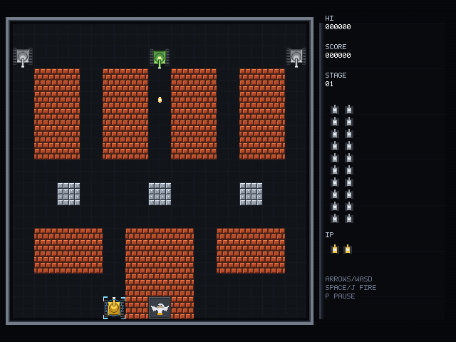

# Battle City · C/C++ native 迁移

这是 [samples/tank](../tank/) 的 **native 脚本迁移版**：场景、prefab、美术、音频、关卡和
Lua HUD 全部复用；只把根玩法脚本从 `game.lua` 换成 C++ guest `game_native.cpp`。

> 文件名按请求保留为 **`tank-nativel.scn`**（`samples/tank-native/tank-nativel.scn`）。
> 同目录的 `tank.scn` + `game.lua` 是原 Lua 版，便于 A/B 对照。



## 结构

```text
samples/tank-native/
├── tank-nativel.scn      根场景：script = game_native.cpp
├── game_native.cpp       C++ guest：完整玩法（关卡/玩家/敌人/道具/autoplay/HUD 发布）
├── tank.scn + game.lua   原 Lua 版（对照）
├── ui/hud.scn + hud.lua  独立 Lua HUD（通过 global_* 通信，未迁到 C++）
├── actors/ stages/ art/ audio/  与 samples/tank 相同
└── CMakeLists.txt        动态 guest + 静态 guest 宿主 + tank_native_* e2e
```

- **混合语言**：根脚本是 native，HUD 是 Lua。二者不共享对象，只通过
  `hud.mode/score/hi/stage/lives/enemy/overlay/prompt` 这组 `global_*` 值通信。
- **动态 guest**：只包含生成的 `maque_guest_api.h` / `maque/script.hpp`，产物是
  `.so/.dll`；API 表在 `create` 时由宿主注入。
- **静态 guest**：`maque_add_native_script_static(...)` 把同一份 `game_native.cpp`
  编成 OBJECT 库，并生成注册 TU；宿主链接后走 `static:<key>`，不产生/加载 `.so`。
- **分发**：动态 manifest 把源路径映射到 `.so`；静态 manifest 只写
  `"kind":"static","key":"..."`，运行时查进程内注册表。

## 运行

### 动态 `.so`（默认）

```bash
cmake -S . -B build -G Ninja -DCMAKE_BUILD_TYPE=Debug
cmake --build build --target tank_native_game maque_player

MAQUE_AUDIO=sdl \
MAQUE_NATIVE_MANIFEST="$PWD/build/samples/tank-native/manifest.json" \
  ./build/samples/player/maque_player samples/tank-native/tank-nativel.scn
```

或 `./samples/tank-native/run.sh`。

### 静态链接（无 `.so`）

`tank_native_static_player` 复用同一个 `samples/player/main.cpp`，链接
`$<TARGET_OBJECTS:tank_native_static>`；`MAQUE_NATIVE_INFO=1` 会打印
`native 'game_native.cpp' -> static:tank_native_game`。

```bash
cmake --build build --target tank_native_static_player

MAQUE_AUDIO=sdl MAQUE_NATIVE_INFO=1 \
MAQUE_NATIVE_MANIFEST="$PWD/build/samples/tank-native/manifest-static.json" \
  ./build/samples/tank-native/tank_native_static_player samples/tank-native/tank-nativel.scn
```

静态 manifest 由 CMake 生成（`manifest-static.json`），内容只有：

```json
{ "scripts": { "game_native.cpp": { "kind": "static", "key": "tank_native_game" } } }
```

Android/iOS/WASM 的生产宿主同样把静态 guest 的 OBJECT 文件加进去即可；平台级
Gradle/Xcode/WASM 集成仍是后续项（见 [plans/26](../../plans/26-cpp-scripts.md) §5.4）。

## 迁移范围

| 能力 | 状态 |
|---|---|
| 标题 → 点击/Enter → 新游戏 | ✅ |
| 动态 `scene_unload` / `scene_instantiate` 关卡加载 | ✅ |
| 玩家移动/转向吸附/冰面滑行/开火/护盾 | ✅ |
| 子弹步进/砖块 2×2 破坏/钢块/基地摧毁 | ✅ |
| 4 类敌人、出生点选择、AI/射击、装甲血量 | ✅ |
| 子弹池/爆炸池/出生特效池 | ✅ |
| 6 种道具（star/helmet/grenade/shovel/tank/timer） | ✅ |
| 水/树/冰地形、水波动画、铲子钢墙 | ✅ |
| HUD 全局通道（标题/分数/生命/关卡/敌人计数） | ✅ |
| 暂停 / GAME OVER / 回标题 | ✅ |
| 清关 → 下一关（`stageN.scn` 循环） | ✅ |
| autoplay BFS、`MAQUE_TANK_*` 全部测试钩子 | ✅ |
| `tank_e2e.sh` 的 smoke/play/rules 断言 | ✅ 在 native 上复用 |
| 动态 `.so` / 静态注册两条加载路径 | ✅ desktop |

`tank_zorder` 是引擎 2D z_index 的独立场景回归（不依赖根脚本），仍由原测试覆盖。

## 测试

```bash
ctest --test-dir build -R 'tank_native' --output-on-failure
```

| CTest | 覆盖 |
|---|---|
| `tank_native_smoke` | 跳过标题 → 动态 stage → 玩家/敌人出生 → play（动态 `.so`） |
| `tank_native_title` | 标题点击 → 新游戏 → stage → play（动态 `.so`） |
| `tank_native_e2e_smoke` | 复用 `tank_e2e.sh smoke`（动态 `.so`） |
| `tank_native_input` | W 移动 + 空格开火（动态 `.so`） |
| `tank_native_play` | 复用 `tank_e2e.sh play`：2200 帧 autoplay + world_trail 一致（动态 `.so`） |
| `tank_native_rules` | 复用 `tank_e2e.sh rules`：砖/基地/6 道具/清关/stage3/音频（动态 `.so`） |
| `tank_native_static` | 静态 manifest → `static:tank_native_game`（无 `.so`） |
| `tank_native_static_smoke` | 静态 guest 跑通 stage/玩家出生/play |

原 `tank_smoke` / `tank_play` / `tank_rules` / `tank_zorder` 仍由
[samples/tank](../tank/) 的 Lua 版覆盖；native 版在自己的目录下复用同一套
`tests/tank_e2e.sh` 断言，不注册同名 CTest。

## 设计说明

完整的设计/分发矩阵见 [plans/26-cpp-scripts.md](../../plans/26-cpp-scripts.md)。
HUD 有意保留 Lua：它证明两种语言可以在同一场景树里通过事件/全局通道协作。
native 根脚本的日志前缀与 Lua 版一致（`tank:`），因此 `tank_e2e.sh` 的
`smoke/play/rules` 断言可以原样复用；这也是本次迁移的兼容性验收点。

静态路径的构建约束：guest 源文件用 `MAQUE_SCRIPT_STATIC(Class, Id)` 导出唯一
`mq_guest_vt_<Id>()`，`maque_add_native_script_static` 生成全局构造期注册 TU；
宿主只需链接 OBJECT 文件，不需要 `dlopen`/manifest artifact。
