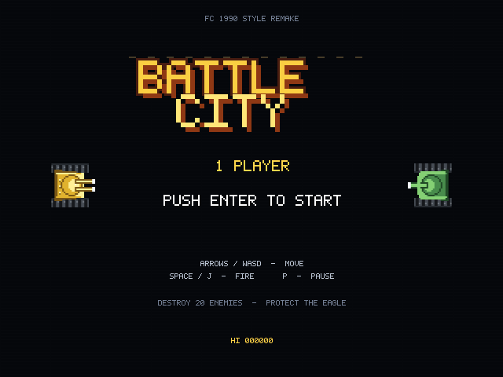
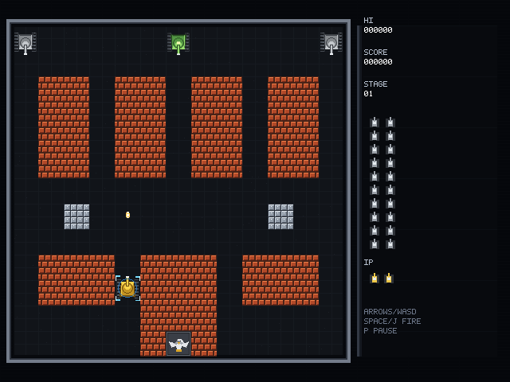
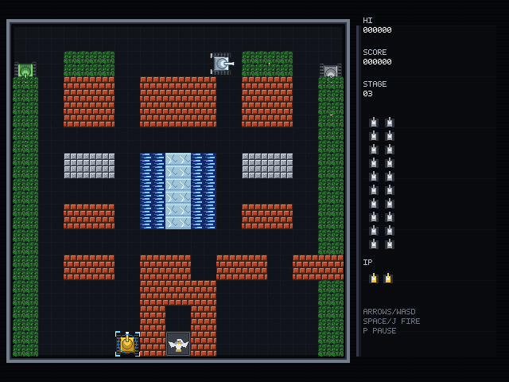

# Battle City · FC 1990 风格的坦克大战（Lua 复刻）



> C/C++ native 迁移见 [samples/tank-native](../tank-native/)（根玩法 C++、HUD 仍 Lua；play/rules 复用同一套 e2e）。

这是一个**完全用 Lua + `.scn` 资源实现**的《坦克大战》复刻：13×13 大格关卡、4 类敌人、
老鹰基地、6 种道具、20 辆敌人/关、3 条命、星级升级、砖/钢/水/树/冰五种地形，
以及标题、关卡演出、暂停、过关、GAME OVER 的完整流程。

它同时是 maque 的**场景组织/嵌套/复用**标杆示例：

- **关卡是数据**：`stages/stageN.scn` 是这一关地形的唯一真相；根脚本实例化它、遍历一次子树建碰撞网格，
  Lua 里不再抄一份地图。
- **实体池用 prefab**：坦克、子弹、爆炸、道具全部来自 4 个可复用 prefab，运行期只 `set_active`/换纹理，
  不 spawn/destroy。
- **HUD 是独立嵌套场景**：`ui/hud.scn` 有自己的 VM、自己的实体池；它不抓根脚本的局部变量，
  只读共享的 `global_*` 通道。标题闪烁、暂停/结算面板、位图字体排版都在 HUD 里。
- **有行为用 `.scn`，纯数据用 prefab**：HUD 有行为 → 嵌套场景；actor 池和关卡地形无行为 → 纯数据场景。
- **切关 = 卸载/实例化一个场景**：`scene_unload` + `scene_instantiate`，根场景、全局状态和 HUD 不重建。



## 运行

推荐用自带启动器（会自动 `MAQUE_AUDIO=sdl`，否则引擎默认 null 后端没有声音）：

```bash
# 从仓库根目录
./samples/tank/run.sh
```

Windows：

```powershell
.\samples\tank\run.cmd
```

也可以手动启动并显式打开 SDL 音频：

```bash
MAQUE_AUDIO=sdl ./build/samples/player/maque_player samples/tank/tank.scn
```

> 引擎为了 CI/headless 默认使用 null 音频后端（逻辑照常推进、不出声）。
> 想静音玩：`MAQUE_AUDIO=off ./build/samples/player/maque_player samples/tank/tank.scn`。

操作（经典 FC 手感，方向键固定四向移动）：

| 键 | 作用 |
|---|---|
| `↑/↓/←/→` 或 `W/A/S/D` | 坦克移动（转向时自动吸附到 16px 网格） |
| `Space` / `J` / `Z` | 开火（按住连发，受冷却/在场子弹数限制） |
| `P` | 暂停 / 继续 |
| `Esc` | 返回标题 |
| `Enter` / `Space` / 鼠标左键 | 开始游戏、确认 |

## 场景结构

```text
samples/tank/
├── tank.scn                    根场景：背景/战场框 + 三个嵌套实例；唯一脚本 game.lua
├── game.lua                    玩法：关卡加载/碰撞/敌人 AI/道具/计分/发布 HUD 数据
├── actors/
│   ├── actors.scn              纯数据：46 个 actor prefab 实例（池）
│   ├── tank.prefab.json        坦克（玩家/敌人共用）
│   ├── fx32.prefab.json        32×32 特效（爆炸/出生/道具/护盾）
│   ├── bullet.prefab.json      8×8 子弹
│   ├── title_tank.prefab.json  标题画面 64×64 坦克
│   └── muzzle.prefab.json      16×16 炮口焰
├── ui/
│   ├── hud.scn                 嵌套场景：HUD 面板/logo/标题坦克
│   └── hud.lua                 HUD 独立 VM：位图字体、标题、暂停/过关/结算
├── stages/
│   ├── stage1.scn ... stage4.scn   纯数据关卡：tile_* 节点 + 基地 + 出生点
│   └── （由 tools/make_tank_scenes.py 从 13×13 大格地图生成）
├── art/                        程序化像素资源（tools/make_tank_art.py）
├── audio/                      程序化 8-bit 音效/BGM（tools/make_tank_audio.py）
└── CMakeLists.txt              4 个 CTest
```

### 组合关系

```text
tank.scn（根实例 0，game.lua）
  ├─ bg / field_bg / field_frame             根场景静态节点
  ├─ ActorsHost
  │    └─ SceneInstance → actors/actors.scn  46 个 prefab 根：p_/e1_/b01_/x01_/...
  ├─ HudHost
  │    └─ SceneInstance → ui/hud.scn         独立 VM；读 global_*，不依赖 game.lua
  └─ StageHost（根场景节点）
       └─ (动态) SceneInstance → stages/stageN.scn
            ├─ stage_root
            ├─ tile_c09_r10_brick ...       每格一个 16×16 sprite（名字 = 数据）
            ├─ base_eagle                   基地
            └─ player_start / spawn_1..3    出生点
```

### 为什么要这么分

| 决策 | 原因 |
|---|---|
| 关卡地形不写进 Lua | 关卡是**数据**；改地图只改/重生成 `.scn`。根脚本用 `node_child_count/node_child_at` 遍历一次子树，从节点名 `tile_c09_r10_brick` 建立 26×26 碰撞网格。地图只有一个真相。 |
| stage 没有 script | 它没有独立行为（地形/基地/出生点），只是纯数据。行为统一由根脚本负责，避免 676 个 tile 各自有 VM。 |
| HUD 有自己的 script | HUD 的行为（标题闪烁、面板、位图字体、结算）独立于玩法；它用自己 VM + 自己实体池。根脚本只写 `hud.*` 全局值，不跨实例抓节点。 |
| actor 池用 prefab | 46 个池对象在装配期全部创建；关卡切换/重开只重置位置/显隐/纹理。运行期没有 `entity_spawn/destroy`，避免掉帧与实体 id 增长。 |
| 池对象**不**做动态 `node_add_component` | prefab 在加载期解析 Sprite/Transform，素材预解析；池对象直接 `set_active` 复用。 |
| `node_set_z_index` 分层 | 地形 10、坦克 20、子弹 30、树 40、特效 50、HUD 100、文字 9000。树能正确盖住坦克，HUD 永远在战场之上（见下文缺陷 013）。 |

### 关卡加载流程

1. `game.lua` 的 `request_stage(n)`：`scene_unload` 旧 stage，`scene_instantiate(StageHost, "stages/stageN.scn")`。
2. 动态实例在**下一个帧边界**构建完成（engine docs/32 §7），期间 HUD 显示 `STAGE NN`。
3. `collect_stage()` 从 `stage_root` 向下遍历：`tile_*` → 网格 + 视觉节点；`base_eagle` → 基地；
   `player_start`/`spawn_N` → 出生点。
4. 重置 actor 池、生成敌人队列、玩家出生 → `intro` 1.6s → `play`。

换关只卸载/实例化 stage；根场景、HUD VM、全局状态、actor prefab 都不重建。

## 玩法（对齐 1990 FC 版）

| 规则 | 实现 |
|---|---|
| 战场 | 26×26 个 16px 单元（= 26×26 个 8px 源单元 ×2），13×13 大格地图 |
| 玩家 | 3 条命（2 个备用），出生护盾 3s，受击即死，死亡后星级归零 |
| 敌人 | basic/fast/power/armor 四类；同屏最多 4、每关 20；三个出生点；出生动画 + 1s 无敌 |
| 装甲 | 4 血，受击换色；闪红坦克掉道具 |
| 砖/钢 | 砖逐格可碎；钢只有 3 星玩家的子弹能碎 |
| 水/树/冰 | 水挡坦克不挡子弹；树在坦克之上；冰面加速且短暂滑行 |
| 基地 | 老鹰 2×2 单元；任何子弹击中 → GAME OVER |
| 道具 | star / helmet / grenade / shovel / tank / timer；拾取即生效 |
| shovel | 基地三面 16 格变钢 12s，最后 3s 闪烁，结束回砖 |
| 计分 | 100/200/300/400；2 万、4 万… 加命 |
| 关卡 | 4 张地图循环，循环后敌人配置更硬；清空 20 辆且无在途坦克后过关 |



## 测试

```bash
ctest --test-dir build -R 'tank' --output-on-failure
```

| CTest | 覆盖 |
|---|---|
| `tank_smoke` | 标题点击 → 新游戏 → 动态 stage 场景加载 → intro → play |
| `tank_play` | autoplay 2200 帧：开火/打砖/命中/击杀/计分 + 两次 `world_trail` 逐位一致 |
| `tank_rules` | 真实弹道的砖块摧毁、基地摧毁、6 种道具（spawn→碰撞拾取→效果）、清关→stage2 场景切换、stage3 场景加载 |
| `tank_zorder` | 2D `z_index` 回归：中心像素必须是 z 更高的绿色 |

测试钩子（只改布场/输入，不改命中与计分逻辑）：

```bash
MAQUE_TANK_SKIP_TITLE=1   # 跳过标题
MAQUE_TANK_STAGE=3        # 从第 3 关开始
MAQUE_TANK_AUTOPLAY=1     # 自走（BFS 寻路 + 瞄准/开火），用于长跑/确定性
MAQUE_TANK_GOD=1          # 玩家不掉命（测试用；基地仍可被毁）
MAQUE_TANK_TRACE=1        # 每 60 帧输出战况
MAQUE_TANK_BRICK_AT=130   # 第 130 帧把玩家放到砖块前并开火
MAQUE_TANK_BASE_AT=130    # 第 130 帧把玩家放到基地上方并开火
MAQUE_TANK_POWER_AT=130   # 第 130 帧在玩家脚下生成道具
MAQUE_TANK_POWER_KIND=shovel  # 与上一条配合：star/helmet/grenade/shovel/tank/timer
MAQUE_TANK_CLEAR_AT=140   # 第 140 帧清空队列/击毁在场敌人，验证清关→下一关场景切换
```

截图：

```bash
MAQUE_HEADLESS=1 maque_player --shot title.png --shot-frame 50 samples/tank/tank.scn
MAQUE_HEADLESS=1 MAQUE_TANK_SKIP_TITLE=1 maque_player --shot play.png --shot-frame 200 samples/tank/tank.scn
```

## 引擎缺陷与改进（本轮）

### 013 · `scn.Sprite` 的 `node_set_z_index` 被静默忽略（fixed）

- **现象**：树总是画在坦克下面、HUD 过场文字被地形砖块盖住；`node_z_index(id)` 能读回 9000，
  但渲染顺序仍等于实体创建顺序。
- **根因**：`Scene::extract` 对 sprite 写的是 `it.z = id`，没有读 `Entity::z_index`（UI/Spine 都读了）。
- **修复**：改为 `it.z = z_index * 100000 + id`，与 UI/Spine 使用同一稳定键（同 z 再按 id）。
- **回归**：`tank_zorder`（`tests/data/zorder/zorder.scn`）断言中心像素是 z=9000 的绿色；
  游戏内树/水/冰/HUD 的分层也依赖它。
- 文件：`docs/bugs/013-sprite-z-index-ignored.md`；代码：`modules/runtime/src/runtime.cpp`。

### 已知边界 / 下一步（不是 bug，但值得知道）

1. **`render.TileMap` 目前只有 schema，没有 2D 提取实现**。本示例用“每格一个 sprite 节点”的
   stage 场景；26×26 只有 200~300 个非空节点，可接受。等 TileMap 落地后，stage 可以更紧凑。
2. **`.scn` 的节点 `z_index` 没有 JSON 字段**（只能运行期 `node_set_z_index`）。所以 stage tile 的
   分层在 `collect_stage` 里设置；如果未来节点元数据能序列化 z，这段可以删。
3. **动态场景实例在帧边界构建**：切关后有一帧“加载中”。本示例用 HUD 的 `STAGE NN` 遮住，
   不是阻塞等待；这是 docs/32 的确定性语义。
4. **Lua 单 chunk 的局部变量上限 200**：本工程把大量私有 helper 写成脚本全局函数（单 VM 内隔离），
   并将 HUD 拆到独立 VM。更规范的长期方案是脚本包/模块化，下一步。
5. 只实现 1P；2P 合作、关卡编辑器、高分存档、attract demo 未做。
6. 音效/BGM 是原创的 8-bit 合成，不是 FC 原曲/原素材；必须 `MAQUE_AUDIO=sdl`（或 `auto`）才出声。
   推荐直接用 `./samples/tank/run.sh`（已默认设置）；引擎默认 null 后端，所以直接跑
   `maque_player samples/tank/tank.scn` 会是静音。

## 资源生成

所有像素资源与音频都由脚本确定性生成，不依赖外部素材库：

```bash
python tools/make_tank_art.py
python tools/make_tank_audio.py
python tools/make_tank_scenes.py
```

- `make_tank_art.py`：tile/tank/基地/道具/爆炸/护盾/字形/logo/标题坦克；
- `make_tank_audio.py`：WAV SFX + 4s 循环 BGM（22050Hz mono）；
- `make_tank_scenes.py`：从 13×13 地图生成 4 个 `stages/stageN.scn`，同时保证基地 2×2、
  周围 shovel 砖块、玩家/敌人出生点 2×2 清空。

## 确定性

固定 `dt=1/60`、只用引擎 `rng()`、无墙钟/异步、实体池在装配期创建、关卡切换只做场景实例化。
`tank_play` 用两次独立进程的 `world_trail` 和击杀序列逐字比较。
