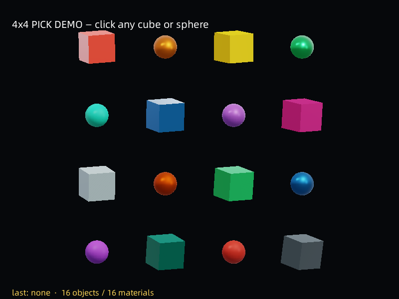

# 4x4 拾取 Demo



```bash
./build/samples/player/maque_player scenes/pick_demo/pick_demo.scn
```

- **16 个独立对象**：8 个 cube（内建网格）+ 8 个 sphere（`assets/sphere.mesh.json`）；
  每个对象带自己的 `asset.PbrMaterial`（16 组不同 base color + metallic/roughness）。
- **点击 = 拾取 + 换色**：`on_pointer_down` → `scene_pick(x, y)` 命中最近对象 → 该对象的
  `base_color` 换成调色板下一色（并加一点 `emissive` 发光）；控制台打印
  `[pick_demo] hit name=... palette=... clicks=...`，底部 HUD 同步显示。
  同一对象连续点击按调色板轮换（`clicks` 递增）；点在对象空隙会打印 `miss`。
- **坐标**：`scene_pick(x, y)` 与 `input_x` / `input_y` 同一套（**设计坐标**；2D 场景里就是世界坐标）。
  如果要从 3D 世界坐标发射线，用 `scene_raycast(ox, oy, oz, dx, dy, dz, max_distance)`。
- **改材质颜色**：`node_set_number(id, 'asset.PbrMaterial', 'base_color.r', v)` ——
  `node_get_number` / `node_set_number` 的 `field` 支持嵌套路径（`base_color.r`、`local.position.x` …）。

## 回归

```bash
ctest --test-dir build -R pick_demo_e2e --output-on-failure
```

测试用 `MAQUE_SIM` 的世界空间点击（设计坐标 = 对象屏幕中心）验证：命中的对象名、二次点击换色、
空隙 miss、两次运行日志一致，以及截图的非背景占比 / 颜色多样性。
